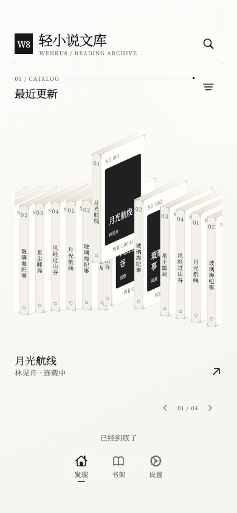
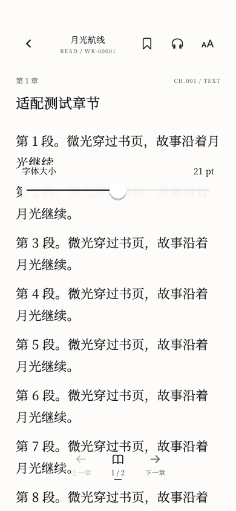

<p align="center">
  
</p>

<h1 align="center">轻小说文库 · Flutter</h1>

<p align="center">把界面留给故事。<br />奶白玻璃、档案式排版，与一座可以轻轻翻动的书架。</p>

<p align="center">
  <a href="https://github.com/mikufoxxx/Wenku8_Flutter/actions/workflows/flutter-ci.yml"></a>
  <a href="https://github.com/mikufoxxx/Wenku8_Flutter/releases"></a>
  <a href="assets/licenses/GPL-3.0.txt"></a>
  
</p>

<p align="center">
  <a href="https://github.com/mikufoxxx/Wenku8_Flutter/releases">下载与版本</a> ·
  <a href="#开始阅读">使用指南</a> ·
  <a href="#构建与贡献">构建</a> ·
  <a href="CHANGELOG.md">更新记录</a> ·
  <a href="docs/THIRD_PARTY.md">第三方许可</a>
</p>

---

面向 **Android** 的轻小说客户端，基于 [MewX / light-novel-library_Wenku8_Android](https://github.com/MewX/light-novel-library_Wenku8_Android) 重构。保留原项目署名与许可，以 Flutter 重新实现发现、书架、阅读器及交互组件。当前项目不是文库网站的官方应用。

## 一眼看看

<p align="center">
  
  &nbsp;
  
  &nbsp;
  
</p>
<p align="center"><sub>应用实际渲染 · 独立演示数据与程序绘制封面，不含个人账号、书架或通知。</sub></p>

### 读起来，也要顺手

- **发现故事** — 分类、排行、书名与作者搜索、出版文库；循环书架带吸附、惯性与轻触反馈。
- **接着上次读** — 本地书架、阅读历史、章节续读、书签；点按书签回到段落中央并短暂高亮。
- **排版即时可见** — 字号、行距、夜间主题、系统字体 / 内置思源宋体。拖动排版滑杆时，设置底板与遮罩透明，正文实时变化；松手后保存。
- **阅读工具齐全** — 目录、章内查找、插图查看与分享、章节缓存、缓存管理、备份恢复及旧版书架导入。
- **放下手机听** — 免费在线中文神经网络音色，后台播放、耳机与锁屏控制、睡眠定时、段落跟随。**系统离线语音待开发**。
- **按设备选择效果** — 折射、背景模糊、滚动边缘模糊、过渡动效和立体书架均可单独关闭。
- **更新有据可查** — 关于页显示版本与构建号、更新说明；支持 GitHub Releases 检查、下载校验和 Android 确认安装。

文库账号、云书架、书评与回复依赖对应在线服务。网络受限或服务变动时，已经缓存的章节仍可阅读。

## 开始阅读

### 安装与升级

1. 打开 [Releases](https://github.com/mikufoxxx/Wenku8_Flutter/releases)，下载适合设备的 APK。大多数近年的 Android 手机选择 **`arm64-v8a`**；旧 ARM 设备选择 `armeabi-v7a`；x86_64 设备 / 模拟器选择 `x86_64`。
2. 按 Android 提示安装。应用不会自行授予安装权限，也不会静默安装更新。
3. 后续在 **设置 → 关于 → 关于轻小说文库** 检查新版本。

自动检查只在应用前台进行，间隔至少六小时，可随时关闭；不会自动下载。草稿与预发布版本不进入自动更新渠道。

> 正式版与本地调试预览版的签名可能不同。出现“签名不一致”时，先导出本地备份，勿直接卸载现有应用。不同签名不能直接覆盖升级；同一正式渠道后续使用固定签名。

### 书签与排版

在阅读器打开 **书签 → 添加当前位置书签**。下次点按对应书签，即可回到保存段落；定位高亮会自行淡出。打开 **阅读设置** 调整字号或行距，按住滑杆即可直接看正文效果。

全局字体在 **设置 → 内置思源宋体** 切换。内置的是可合法随应用分发的 Adobe 思源宋体 CN，不是从 OPPO 系统提取的字库；关闭后使用系统字体。

### 听书

在阅读器点击耳机按钮，选择在线音色后开始。双击正在朗读的段落可暂停 / 继续；双击其他文字段落可从那里听起。手动滚动会暂时停止跟随，可在听书面板重新开启。

进度条代表**整章文本进度**，支持拖动；当前语段的音频时间单独显示。系统媒体条目以章节为单位，不随每段音频重新建立。插图与纯符号会自动跳过，个别语段失败会尝试恢复，连续失败时暂停并提示。

**自然在线需要联网生成未缓存语段**，会把待朗读文本发送给语音服务；已生成语音在设备本地缓存。无需付费订阅或输入私有 API Key。系统离线语音当前仅展示“待开发”，不会检测或调用本机 TTS 引擎。

### 让旧设备轻一点

进入 **设置 → 性能与流畅度 → 低性能设备模式**。首次开启采用轻量预设，可逐项恢复：

| 效果 | 关闭后 |
| --- | --- |
| 液态玻璃折射 | 改用轻量奶白底板 |
| 背景模糊 | 取消玻璃底板与封面背景的模糊 |
| 滚动边缘模糊 | 取消页面上下边缘的渐变模糊 |
| 过渡动效 | 简化页面、菜单与内容切入 |
| 立体书架 | 改用平面循环封面轮播 |

选择即时生效并保存；阅读记录、缓存与听书不受影响。系统“减少动态效果”设置仍优先生效。实际刷新率与流畅度取决于设备、系统调度及效果配置。

## 构建与贡献

使用 **Flutter 3.41.5 / Dart 3.11.3、JDK 17、Android SDK**。

```sh
git clone https://github.com/mikufoxxx/Wenku8_Flutter.git
cd Wenku8_Flutter
flutter pub get
flutter analyze
flutter test
flutter build apk --release --target-platform android-arm64
```

无签名配置时构建本地调试证书预览包。正式分发请使用自己的长期签名，不要将 keystore、`key.properties`、口令或本地 SDK 路径提交到 Git。

### GitHub Actions

- **Flutter Android**：静态检查、自动测试、原生单元测试及 ARM64 预览构建。
- **Build Android APKs**：手动构建三种架构；推送与版本号一致的 `v版本号` 标签时，构建 APK、打包工程源码并创建草稿 Release。正式标签必须配置固定签名。

本项目没有把 Actions Artifacts 当作正式更新源。先核对草稿附件与许可，再发布 Release，应用才会检测到它。签名 Secrets、版本号与发布步骤见 [构建发布指南](docs/RELEASING.md)。

### 工程导航

```text
lib/                  页面、交互、阅读器与本地状态
lib/listening/        听书会话、在线协议、缓存与媒体控制
lib/updates/          版本检查、下载与安装流程
android/              Android 桥接、系统文件与接口运行库
assets/               图标、字体与第三方许可原文
shaders/              玻璃折射与渐变模糊
test/                 状态、交互和布局回归
integration_test/     独立设备集成测试
```

报告问题时请附版本号、Android 版本、复现步骤及所用效果配置。截图、日志请先移除账号、会话、通知、私人书架和阅读内容。涉及安全凭证的问题不要粘贴到公开 Issue。

## 开源、授权与隐私

- **应用源码**：保留原项目 [GPL v2 或后续版本声明](LICENSE)。本 Flutter 组合版本按 [GPL v3](assets/licenses/GPL-3.0.txt) 分发，以兼容 LGPL v3 协议适配代码。感谢 **MewX、Baby Pepper（SeraphRoy）、Jack Liu（aaassseee）** 及原项目所有贡献者。
- **接口运行库**：`libcpp.so` 来自原版应用，按维护者确认的**原样再分发**条件保留，不修改。它是独立授权的二进制，当前工程不含其对应源码；不能把本项目的 GPL 许可扩展解释为该库的修改权。详见 [第三方组件与条件](docs/THIRD_PARTY.md)。
- **字体**：Adobe Source Han Serif CN，SIL OFL 1.1；保留原始字库和授权文本。不打包 OPPO 专有系统字体。
- **在线语音协议适配**：[rany2/edge-tts](https://github.com/rany2/edge-tts)，LGPL v3。代码与许可随源码提供。
- **内容**：小说、封面与插图归各自权利人所有，不随应用源码授权转让。

公开源码与示例图不包含个人账号、会话、真实阅读缓存、设备标识、调试录音或签名私钥。文库登录及阅读请求发送给对应内容服务；在线朗读发送待合成文本给语音服务；更新检查访问 GitHub。应用不内置维护者的账号或 GitHub Token。

<p align="center"><sub>保留故事的空间，也保留对原作者与开源社区的尊重。</sub></p>
